# 🚢 Análisis Exploratorio de Datos Titanic

## **Objetivo**: ¿Qué factores determinaron quién sobrevivió al hundimiento del Titanic?

Vamos a analizar el dataset del Titanic para entender qué características (edad, clase, sexo, etc.) influyeron en la supervivencia de los pasajeros. Este análisis nos ayudará a identificar patrones y responder preguntas como:
- ¿Las mujeres y niños tuvieron más probabilidad de sobrevivir?
- ¿La clase social (1ra, 2da, 3ra) influyó en la supervivencia?
- ¿Viajar con familia aumentó las posibilidades de sobrevivir?

---

## 📦 Instalación de Librerías

Antes de comenzar, instala las librerías necesarias (si trabajas en un Jupyter notebook en local):

```bash
pip install pandas numpy matplotlib seaborn kagglehub missingno
```

**Nota**: `kagglehub` descarga este dataset público sin necesidad de cuenta. Si te pidiera autenticación, crea una cuenta gratuita en [Kaggle](https://www.kaggle.com/).

---

## 📊 ¿Qué es un EDA (Exploratory Data Analysis)?

Es el proceso de **explorar y entender tus datos** antes de entrenar modelos. Es como conocer a alguien antes de trabajar con esa persona: necesitas saber quién es, qué características tiene, su background laboral, etc.

---

## 🛠️ Paso 0: Configuración Inicial

```python
import pandas as pd
import numpy as np
import matplotlib.pyplot as plt
import seaborn as sns
import kagglehub
import os

# Configuración para que los gráficos se vean mejor
sns.set_style("whitegrid")
plt.rcParams['figure.figsize'] = (10, 6)
```

**¿Qué son estas librerías?**
- **pandas**: Para trabajar con datos en formato de tablas
- **numpy**: Para operaciones matemáticas
- **matplotlib** y **seaborn**: Para crear gráficos bonitos
- **kagglehub**: Para descargar datasets directamente desde Kaggle
- **os**: Para manejar rutas de archivos

---

## 📥 Paso 1: Cargar los Datos

```python
import kagglehub
import os

# Descargar el dataset del Titanic desde Kaggle
path = kagglehub.dataset_download("yasserh/titanic-dataset")
print("Path to dataset files:", path)

# Cargar el archivo Titanic-Dataset.csv
df = pd.read_csv(os.path.join(path, 'Titanic-Dataset.csv'))
```

**Dataset oficial**: https://www.kaggle.com/datasets/yasserh/titanic-dataset

**¿Qué es df?**  
Es un **DataFrame**, una tabla donde cada fila es un pasajero y cada columna es una característica (edad, sexo, etc.).

---

## 👀 Paso 2: Primera Exploración

### 2.1 Ver las primeras filas

```python
df.head()
```


**¿Por qué?** Para ver cómo lucen los datos y qué columnas tenemos. Si quisieramos que nos devolviera más o menos de 5 filas, podemos simplemente indicarlo dentro del paréntesis: `df.head(15)`

### 2.2 Dimensiones del dataset

```python
df.shape
```
y nos devolverá de la siguiente manera la información `(891, 12)` es decir, 891 filas y 12 columnas, si queremos que la información se vea mejor en el notebook podemos hacer:

```python
print(f"Filas: {df.shape[0]}, Columnas: {df.shape[1]}")
```

**¿Por qué?** Para saber cuántos pasajeros (filas) y características (columnas) tenemos.

### 2.3 Información general

```python
df.info()
```


**¿Qué obtenemos?**
- Tipos de datos (números, texto, etc.)
- Cantidad de valores **no nulos** (valores que existen)
- Memoria que ocupa el dataset

### 2.4 Columnas disponibles

```python
print(df.columns.tolist())
```

**Columnas típicas del Titanic:**
- `PassengerId`: ID único del pasajero
- `Survived`: 0 = murió, 1 = sobrevivió
- `Pclass`: Clase del ticket (1, 2, 3)
- `Name`: Nombre completo
- `Sex`: Sexo (male/female)
- `Age`: Edad en años
- `SibSp`: Número de hermanos/cónyuges a bordo
- `Parch`: Número de padres/hijos a bordo
- `Ticket`: Número de ticket
- `Fare`: Precio del ticket
- `Cabin`: Número de cabina
- `Embarked`: Puerto de embarque (C, Q, S)

---

## 📊 Paso 3: Estadística Descriptiva

```python
df.describe()
```


**¿Qué es esto?**  
Un resumen estadístico de las columnas numéricas:
- **count**: Cuántos valores existen
- **mean**: Promedio
- **std**: Desviación estándar (qué tan dispersos están los datos)
- **min/max**: Valores mínimo y máximo
- **25%, 50%, 75%**: Percentiles (distribución de los datos)

**¿Por qué es útil?**  
Para detectar valores extraños. Por ejemplo, si la edad máxima es 200, hay un error.

### Estadística para columnas categóricas

```python
df.describe(exclude='number')
```
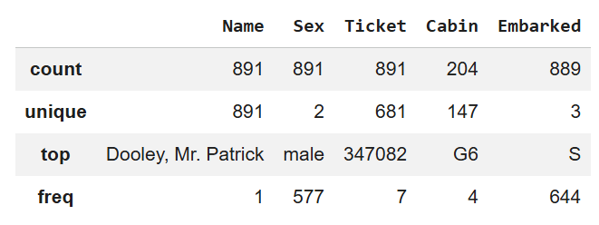

Esto muestra:
- **count**: Cuántos valores hay
- **unique**: Cuántos valores diferentes
- **top**: El valor más frecuente
- **freq**: Cuántas veces aparece el valor más frecuente

---

## 🧹 Paso 4: Limpieza de Datos

### 4.1 Identificar valores faltantes (Missing Values)

```python
print(df.isnull().sum())
```
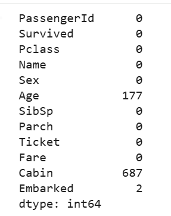

**¿Qué son valores faltantes?**  
Datos que no existen (por ejemplo, edad desconocida). Aparecen como `NaN` (Not a Number).

**¿Por qué importa?**  
Los valores faltantes pueden arruinar nuestro análisis. Debemos decidir qué hacer con ellos.

### 4.2 Visualizar valores faltantes

```python
import missingno as msngno
msngno.matrix(df)
plt.show()
```

O de forma más simple:

```python
# Porcentaje de datos faltantes por columna
missing_percent = (df.isnull().sum() / len(df)) * 100
print(missing_percent[missing_percent > 0])
```

### 4.3 Eliminar columnas irrelevantes

```python
# Eliminar columnas que no aportan al análisis
df = df.drop(['PassengerId', 'Name', 'Ticket', 'Cabin'], axis=1)

# Ver cómo quedó el dataset después de eliminar columnas
print("Dataset después de eliminar columnas:")
df.head()
```
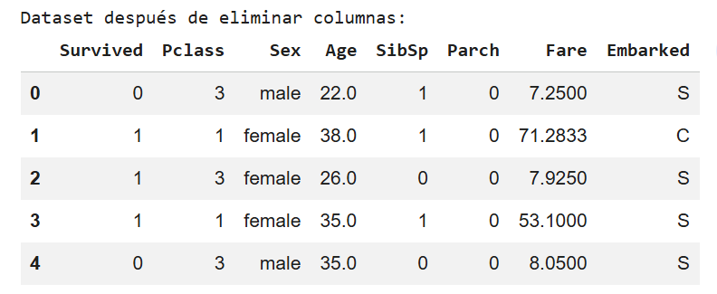

**¿Por qué eliminamos estas columnas?**
- `PassengerId`: Solo es un ID, no influye en la supervivencia
- `Name`: Cada nombre es único, no aporta patrones
- `Ticket`: Números sin patrón claro
- `Cabin`: Tiene demasiados valores faltantes (>70%)

**¿Qué es `axis=1`?**  
Significa que eliminamos **columnas**. `axis=0` eliminaría **filas**.

### 4.4 Imputar valores faltantes en Age

**¿Qué es imputación?**  
Rellenar valores faltantes con valores estimados.

#### Imputar Age (edad) con la mediana

```python
# La mediana es más robusta que el promedio ante valores extremos
median_age = df['Age'].median()
df['Age'] = df['Age'].fillna(median_age)

# Ver las primeras filas para confirmar que se llenaron los valores faltantes
print(f"Valores de Age imputados con la mediana: {median_age}")
df.head(10)
```
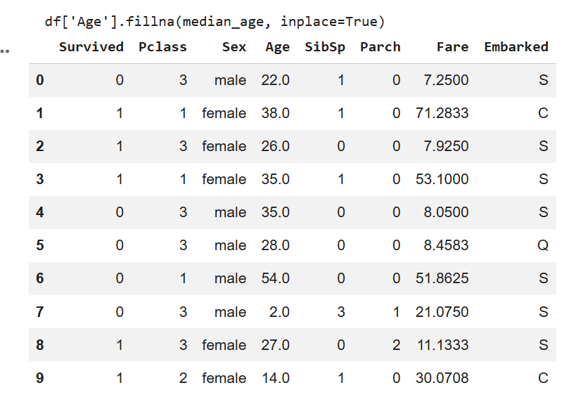

**¿Por qué la mediana y no el promedio?**  
Si hay edades extremas (como 80 años), la mediana no se ve afectada tanto como el promedio.

**¿Por qué `df['Age'] = df['Age'].fillna(...)`?**  
`fillna` devuelve una columna nueva con los huecos rellenados; la guardamos de vuelta en `df['Age']`. (No uses `inplace=True` sobre una columna: en pandas 3 no hace nada.)

### 4.5 Imputar valores faltantes en Embarked

#### Imputar Embarked (puerto de embarque) con la moda

```python
# La moda es el valor más frecuente
mode_embarked = df['Embarked'].mode()[0]
df['Embarked'] = df['Embarked'].fillna(mode_embarked)

# Verificar que se imputaron los valores
print(f"Valores de Embarked imputados con la moda: {mode_embarked}")
df.head(10)
```

**¿Por qué la moda?**  
Para datos categóricos (texto), usamos el valor más común.

### 4.6 Verificar que no queden valores faltantes

```python
print(df.isnull().sum())
# Debe mostrar 0 en todas las columnas
```

---

## 🏷️ Paso 5: Renombrar Columnas (si es necesario)

```python
# Renombrar para mayor claridad (opcional)
df = df.rename(columns={
    'Pclass': 'Passenger_Class',
    'SibSp': 'Siblings_Spouses',
    'Parch': 'Parents_Children'
})

# Ver los nombres nuevos de las columnas
print("Columnas después de renombrar:")
print(df.columns.tolist())
df.head()
```

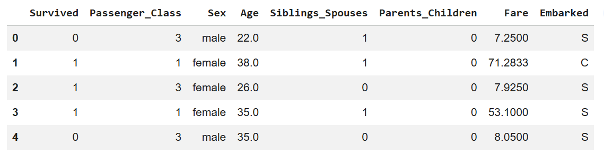

**¿Por qué?**  
Para hacer los nombres más descriptivos y fáciles de entender.

---

## 📈 Paso 6: Análisis Univariado

**¿Qué es?**  
Analizar **una variable a la vez** para entender su distribución.

### 6.1 Variable categórica: Survived

```python
# Contar cuántos sobrevivieron vs murieron
print(df['Survived'].value_counts())

# Visualizar con gráfico de barras
# kind='bar' crea un gráfico de barras vertical
# color=['red', 'green'] asigna rojo a "No sobrevivió" y verde a "Sobrevivió"
df['Survived'].value_counts().plot(kind='bar', color=['red', 'green'])
plt.title('Survival Count')  # Título del gráfico
plt.xlabel('Survived (0 = No, 1 = Yes)')  # Etiqueta del eje X
plt.ylabel('Count')  # Etiqueta del eje Y (cantidad de personas)
plt.xticks(rotation=0)  # Mantener las etiquetas del eje X horizontales
plt.show()
```
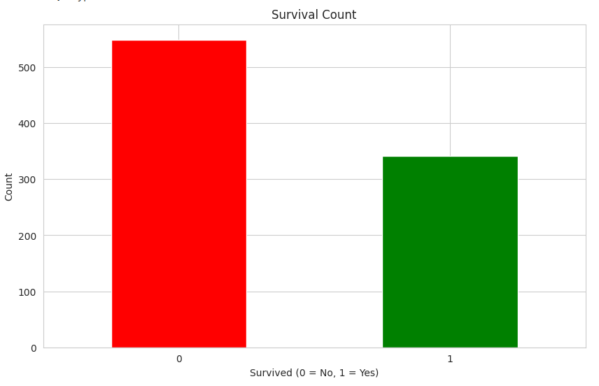

**¿Qué aprendemos?**  
Cuántas personas sobrevivieron vs murieron. Este gráfico nos da una vista rápida del balance de supervivencia.

**¿Para qué sirve?**  
Para entender si hay más sobrevivientes o más fallecidos en el dataset.

### 6.2 Variable categórica: Sex

```python
# Contar cuántos hombres y mujeres hay en el dataset
print(df['Sex'].value_counts())

# Visualizar con gráfico de barras
# Mostramos la distribución de género en el Titanic
df['Sex'].value_counts().plot(kind='bar', color=['blue', 'pink'])
plt.title('Gender Distribution')  # Distribución por género
plt.xlabel('Sex')  # Género (male/female)
plt.ylabel('Count')  # Cantidad de personas
plt.xticks(rotation=0)  # Etiquetas horizontales
plt.show()
```
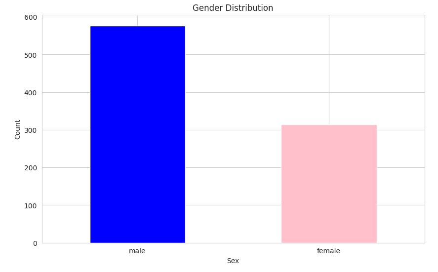

**¿Para qué sirve?**  
Para saber cuántos hombres y mujeres iban en el Titanic. Esto nos ayudará más adelante a analizar si el género influyó en la supervivencia.

### 6.3 Variable numérica: Age

```python
# Histograma para ver la distribución de edades
# bins=30 divide las edades en 30 rangos (ej: 0-3 años, 3-6 años, etc.)
# edgecolor='black' añade un borde negro a cada barra para distinguirlas mejor
# alpha=0.7 hace las barras ligeramente transparentes
df['Age'].plot(kind='hist', bins=30, edgecolor='black', alpha=0.7, color='skyblue')
plt.title('Age Distribution')  # Distribución de edades
plt.xlabel('Age')  # Edad en años
plt.ylabel('Frequency')  # Frecuencia (cuántas personas)
plt.show()
```

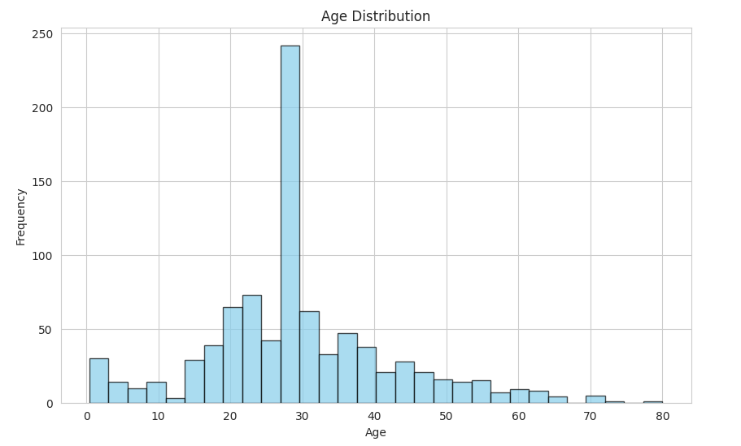

**¿Qué es un histograma?**  
Divide los datos en rangos (bins) y cuenta cuántos valores caen en cada rango.

**¿Qué es `bins=30`?**  
El número de barras en el gráfico. Más bins = más detalle.

**¿Para qué sirve?**  
Para entender qué edades eran más comunes en el Titanic. Por ejemplo, podemos ver si había más adultos que niños.

### 6.4 Variable numérica: Fare

```python
# Boxplot para detectar valores extremos (outliers)
# Un boxplot muestra la distribución de los datos y resalta valores anómalos
df.boxplot(column='Fare', patch_artist=True, 
           boxprops=dict(facecolor='lightgreen'))
plt.title('Fare Distribution')  # Distribución del precio de los tickets
plt.ylabel('Fare')  # Precio del ticket en unidades monetarias
plt.show()
```
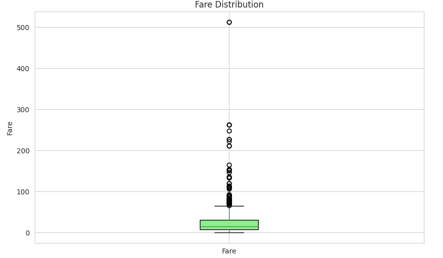

**¿Qué es un boxplot?**  
Muestra la distribución de datos:
- La caja muestra el 50% central de los datos (donde están la mayoría)
- La línea en la caja es la mediana (valor del medio)
- Los puntos fuera son **outliers** (valores extremos, como tickets muy caros)

**¿Para qué sirve?**  
Para detectar si hay tickets con precios muy altos o muy bajos comparados con el resto. Esto puede indicar pasajeros de primera clase con suites de lujo.

---

## 🔗 Paso 7: Análisis Bivariado

**¿Qué es?**  
Analizar la relación entre **dos variables**.

### 7.1 Survived vs Sex

```python
# Tabla cruzada para ver la relación entre sexo y supervivencia
# normalize='index' calcula porcentajes por fila (por cada sexo)
survival_by_sex = pd.crosstab(df['Sex'], df['Survived'], normalize='index') * 100
print("Porcentaje de supervivencia por sexo:")
print(survival_by_sex)
```

**¿Qué es `normalize='index'`?**  
Calcula porcentajes por fila (por sexo). Por ejemplo: del total de mujeres, ¿qué % sobrevivió?

```python
# Gráfico de barras agrupadas para comparar supervivencia por sexo
# Esto nos permite ver visualmente la diferencia entre hombres y mujeres
pd.crosstab(df['Sex'], df['Survived']).plot(kind='bar', color=['red', 'green'])
plt.title('Survival Rate by Gender')  # Tasa de supervivencia por género
plt.xlabel('Sex')  # Género (male/female)
plt.ylabel('Count')  # Cantidad de personas
plt.legend(['Did not survive', 'Survived'])  # Leyenda: rojo=murió, verde=sobrevivió
plt.xticks(rotation=0)  # Mantener etiquetas horizontales
plt.show()
```
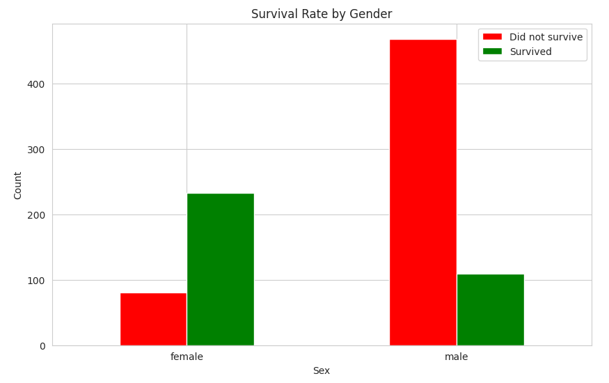

**Conclusión esperada:** Las mujeres tuvieron mayor tasa de supervivencia (política de "mujeres y niños primero").

**¿Para qué sirve?**  
Para confirmar si el género fue un factor determinante en la supervivencia.

### 7.2 Survived vs Passenger_Class

```python
# Análisis de supervivencia por clase de pasajero
# stacked=True apila las barras (muertos + sobrevivientes en la misma columna)
pd.crosstab(df['Passenger_Class'], df['Survived']).plot(kind='bar', stacked=True, 
                                                          color=['red', 'green'])
plt.title('Survival Rate by Passenger Class')  # Supervivencia por clase
plt.xlabel('Passenger Class (1=First, 2=Second, 3=Third)')  # Clase del ticket
plt.ylabel('Count')  # Cantidad de personas
plt.legend(['Did not survive', 'Survived'])  # Leyenda
plt.xticks(rotation=0)
plt.show()
```
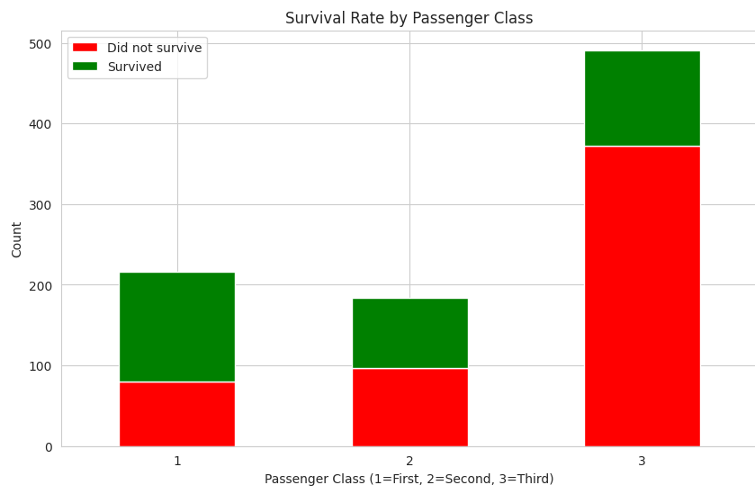

**¿Qué es `stacked=True`?**  
Apila las barras una sobre otra en lugar de ponerlas lado a lado. Así vemos el total de personas por clase.

**¿Para qué sirve?**  
Para ver si la clase social influyó en las probabilidades de sobrevivir. Esperamos que primera clase tuviera mejor acceso a los botes salvavidas.

### 7.3 Age vs Survived

```python
# Distribución de edades por supervivencia
# Comparamos las edades de quienes sobrevivieron vs quienes no
# alpha=0.5 hace los histogramas semi-transparentes para que podamos ver ambos
df[df['Survived']==1]['Age'].plot(kind='hist', bins=30, alpha=0.5, 
                                   label='Survived', color='green', edgecolor='black')
df[df['Survived']==0]['Age'].plot(kind='hist', bins=30, alpha=0.5, 
                                   label='Did not survive', color='red', edgecolor='black')
plt.title('Age Distribution by Survival')  # Distribución de edad según supervivencia
plt.xlabel('Age')  # Edad en años
plt.ylabel('Frequency')  # Frecuencia (cuántas personas)
plt.legend()  # Mostrar leyenda
plt.show()
```
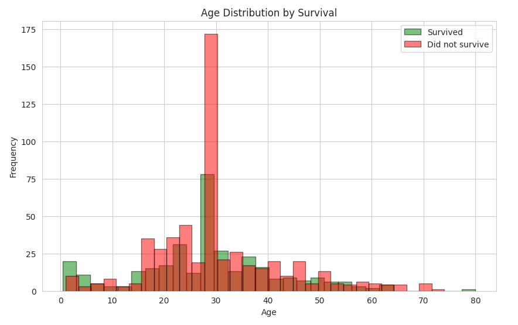

**Ojo con la barra alta cerca de los 28 años:** son los 177 pasajeros sin edad que rellenamos con la mediana (28). No es un patrón real de los datos, es un efecto de nuestra imputación.

**¿Qué es `alpha=0.5`?**  
Transparencia del gráfico (0 = invisible, 1 = opaco). Permite ver ambos histogramas superpuestos.

**¿Para qué sirve?**  
Para identificar si ciertas edades (niños, jóvenes, ancianos) tuvieron más o menos probabilidad de sobrevivir. Por ejemplo, podemos ver si los niños tuvieron prioridad.

### 7.4 Fare vs Survived

```python
# Boxplot comparativo de precios de tickets por supervivencia
# Comparamos cuánto pagaron los que sobrevivieron vs los que no
df.boxplot(column='Fare', by='Survived', patch_artist=True)
plt.title('Fare by Survival Status')  # Precio del ticket según supervivencia
plt.suptitle('')  # Quitar título automático que genera pandas
plt.xlabel('Survived (0 = No, 1 = Yes)')  # Supervivencia
plt.ylabel('Fare')  # Precio del ticket
plt.show()
```
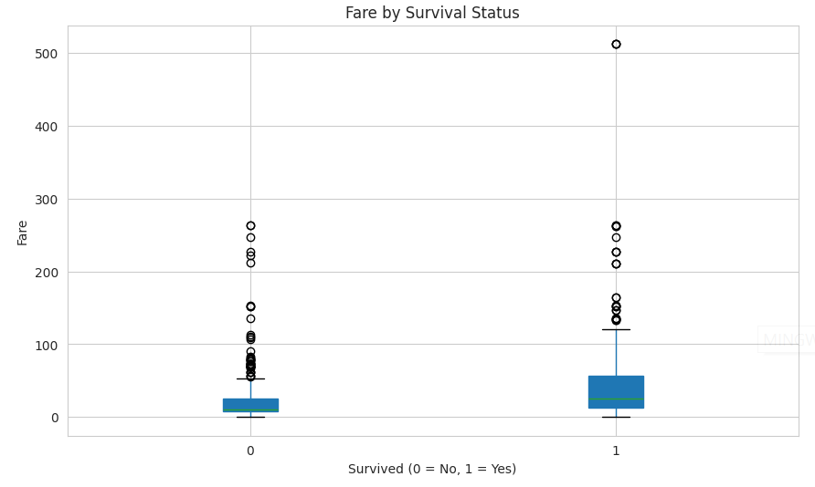

**¿Para qué sirve?**  
Para ver si pagar más dinero (probablemente primera clase) aumentó las posibilidades de sobrevivir. Los tickets más caros suelen estar en mejores ubicaciones del barco.

---

## 🎨 Paso 8: Análisis Multivariado

**¿Qué es?**  
Analizar **múltiples variables** al mismo tiempo.

### 8.1 Matriz de correlación

```python
# Calcular correlaciones SOLO entre variables numéricas
# select_dtypes(include=[np.number]) selecciona solo columnas con números
# Esto evita errores con columnas de texto como 'Sex' o 'Embarked'
numeric_df = df.select_dtypes(include=[np.number])
correlation = numeric_df.corr()
print("Matriz de correlación entre variables numéricas:")
print(correlation)
```


**¿Qué es correlación?**  
Mide qué tan relacionadas están dos variables (-1 a 1):
- **1**: Correlación positiva perfecta (cuando una sube, la otra sube)
- **0**: No hay correlación
- **-1**: Correlación negativa perfecta (cuando una sube, la otra baja)

**¿Por qué solo variables numéricas?**  
La correlación solo funciona con números. Variables de texto como 'Sex' deben convertirse a números primero o excluirse.

### 8.2 Heatmap de correlación

```python
# Crear un heatmap (mapa de calor) para visualizar las correlaciones
plt.figure(figsize=(10, 8))  # Tamaño del gráfico
# annot=True muestra los números dentro de cada celda
# cmap='coolwarm' usa colores: rojo=positivo, azul=negativo
# center=0 centra la escala de colores en cero
# linewidths=1 añade líneas entre celdas para mejor legibilidad
sns.heatmap(correlation, annot=True, cmap='coolwarm', center=0, 
            linewidths=1, fmt='.2f', square=True)
plt.title('Correlation Matrix - Titanic Dataset')  # Título
plt.tight_layout()  # Ajusta el gráfico para que no se corten las etiquetas
plt.show()
```
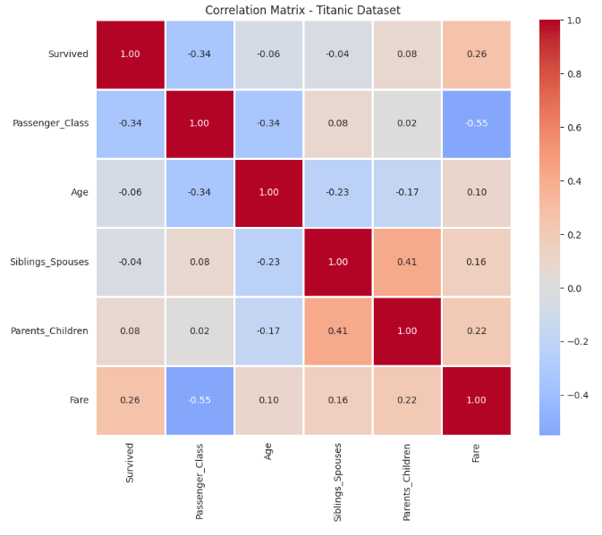

**¿Qué es un heatmap?**  
Un gráfico donde los colores representan valores:
- Rojo/naranja = correlación positiva fuerte (variables que suben juntas)
- Azul = correlación negativa fuerte (cuando una sube, otra baja)
- Blanco = sin correlación (variables independientes)

**¿Qué es `annot=True`?**  
Muestra los números dentro de cada celda para saber el valor exacto.

**¿Para qué sirve?**  
Para identificar rápidamente qué variables están más relacionadas con 'Survived'. Por ejemplo, si 'Passenger_Class' tiene correlación negativa con 'Survived', significa que clases más altas (3) sobrevivieron menos.

### 8.3 Pairplot (gráficos de pares)

```python
# Visualizar relaciones entre todas las variables numéricas
# hue='Survived' colorea los puntos según si sobrevivieron (verde) o no (rojo)
# palette={0: 'red', 1: 'green'} define los colores específicos
# Este gráfico puede tardar un poco porque crea muchas visualizaciones
sns.pairplot(numeric_df, hue='Survived', palette={0: 'red', 1: 'green'}, 
             diag_kind='hist', plot_kws={'alpha': 0.6})
plt.suptitle('Pairplot of Numeric Variables by Survival', y=1.02)  # Título general
plt.show()
```
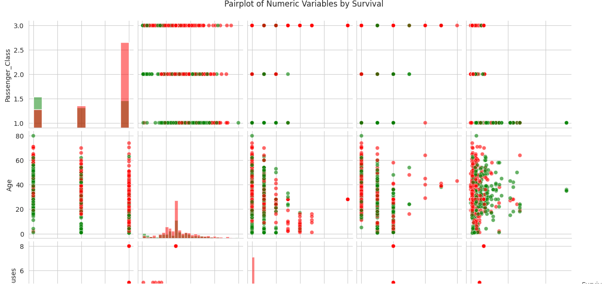
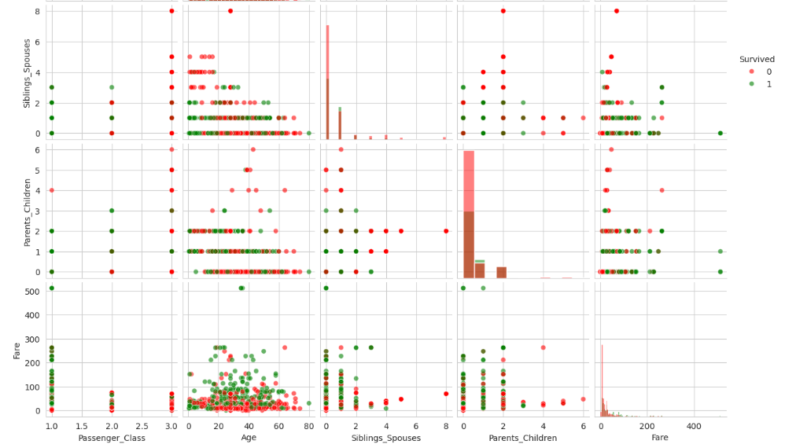

**¿Qué es un pairplot?**  
Crea una matriz de gráficos mostrando todas las combinaciones posibles de variables. En la diagonal muestra histogramas de cada variable.

**¿Qué es `hue='Survived'`?**  
Colorea los puntos según si sobrevivieron o no. Esto nos ayuda a ver patrones de supervivencia.

**¿Para qué sirve?**  
Para identificar visualmente relaciones complejas entre múltiples variables. Por ejemplo, podemos ver si hay un patrón entre edad, precio del ticket y supervivencia simultáneamente.

---

## 📊 Paso 9: Feature Engineering Básico

**¿Qué es Feature Engineering?**  
Crear nuevas variables a partir de las existentes para obtener más información.

### 9.1 Crear variable Family_Size

```python
# Sumar hermanos/cónyuges + padres/hijos + 1 (el pasajero mismo)
df['Family_Size'] = df['Siblings_Spouses'] + df['Parents_Children'] + 1

# Ver las nuevas columnas creadas
print("Nueva columna Family_Size creada:")
df[['Siblings_Spouses', 'Parents_Children', 'Family_Size']].head(10)
```
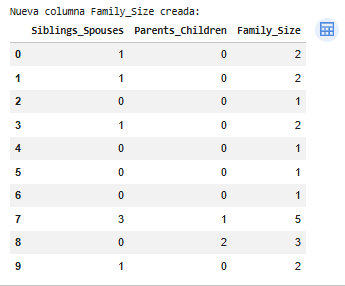

**¿Por qué creamos esta variable?**  
Para ver si viajar en familia influyó en la supervivencia. Alguien solo tiene Family_Size=1, mientras que una familia de 4 tiene Family_Size=4.

```python
# Visualizar la distribución del tamaño de familia
df['Family_Size'].plot(kind='hist', bins=10, edgecolor='black', color='orange')
plt.title('Family Size Distribution')  # Distribución del tamaño de familia
plt.xlabel('Family Size')  # Tamaño de familia (1=solo, 2+=con familia)
plt.ylabel('Count')  # Cantidad de personas
plt.show()
```

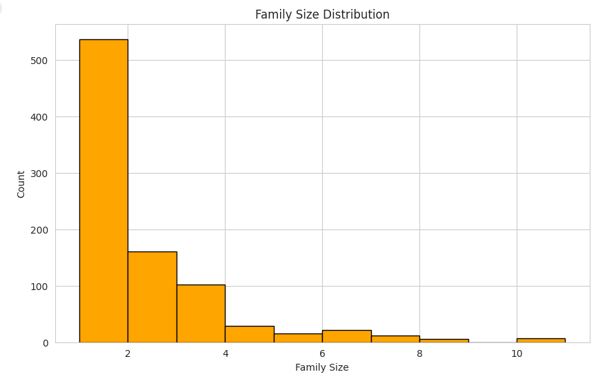

### 9.2 Crear variable Is_Alone

```python
# Crear variable binaria: 1 si viaja solo, 0 si viaja con familia
df['Is_Alone'] = (df['Family_Size'] == 1).astype(int)

# Ver la nueva columna
print("Nueva columna Is_Alone creada:")
df[['Family_Size', 'Is_Alone']].head(10)
```

**¿Qué es `.astype(int)`?**  
Convierte True/False a 1/0. Es más fácil trabajar con números.

```python
# Analizar supervivencia según si viajaban solos o acompañados
# Esto nos ayuda a responder: ¿viajar solo aumentó o disminuyó las chances de sobrevivir?
pd.crosstab(df['Is_Alone'], df['Survived']).plot(kind='bar', color=['red', 'green'])
plt.title('Survival Rate: Alone vs With Family')  # Supervivencia: solo vs acompañado
plt.xlabel('Is Alone (0 = With Family, 1 = Alone)')  # 0=con familia, 1=solo
plt.ylabel('Count')  # Cantidad de personas
plt.xticks(rotation=0)
plt.legend(['Did not survive', 'Survived'])
plt.show()
```
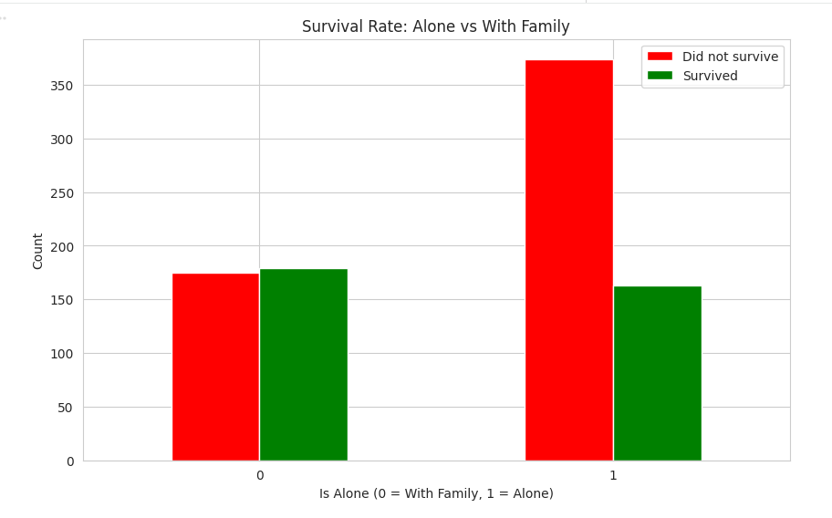

**¿Para qué sirve?**  
Para investigar si estar solo fue una ventaja o desventaja. Quizás los que viajaban solos se movieron más rápido hacia los botes salvavidas.

### 9.3 Crear variable Age_Group

```python
# Categorizar edades en grupos significativos
# bins define los límites de cada grupo
# labels define los nombres de cada categoría
df['Age_Group'] = pd.cut(df['Age'], 
                         bins=[0, 12, 18, 35, 60, 100], 
                         labels=['Child', 'Teenager', 'Young Adult', 'Adult', 'Senior'])

# Ver la nueva columna de grupos de edad
print("Nueva columna Age_Group creada:")
df[['Age', 'Age_Group']].head(15)
```

**¿Qué es `pd.cut()`?**  
Divide una variable continua (edad) en categorías discretas (grupos). Por ejemplo, 5 años → Child, 25 años → Young Adult.

```python
# Analizar supervivencia por grupo de edad
# Esto nos ayuda a ver si "mujeres y niños primero" fue real
pd.crosstab(df['Age_Group'], df['Survived']).plot(kind='bar', color=['red', 'green'])
plt.title('Survival Rate by Age Group')  # Supervivencia por grupo de edad
plt.xlabel('Age Group')  # Grupo de edad
plt.ylabel('Count')  # Cantidad de personas
plt.xticks(rotation=45)  # Rotar etiquetas 45 grados para que no se superpongan
plt.legend(['Did not survive', 'Survived'])
plt.tight_layout()  # Ajustar para que no se corten las etiquetas
plt.show()
```
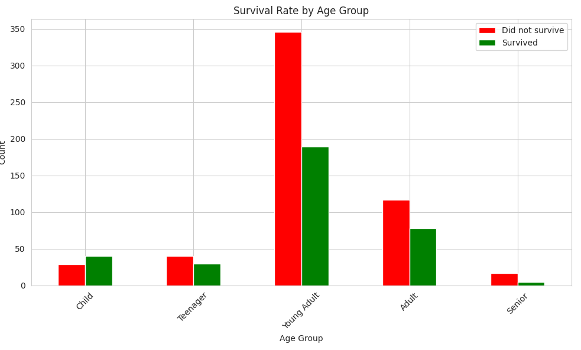

**¿Para qué sirve?**  
Para confirmar si los niños (Child) tuvieron más prioridad de supervivencia que los adultos, como sugiere la frase histórica "mujeres y niños primero".

---

## 📝 Paso 10: Conclusiones

Después de todo el análisis, escribe tus hallazgos:

```python
# Ejemplo de conclusiones basadas en el análisis

print("=== CONCLUSIONES DEL ANÁLISIS ===\n")

# 1. Tasa de supervivencia general
survival_rate = (df['Survived'].sum() / len(df)) * 100
print(f"1. Tasa de supervivencia general: {survival_rate:.2f}%\n")

# 2. Supervivencia por sexo
survival_by_sex = df.groupby('Sex')['Survived'].mean() * 100
print("2. Tasa de supervivencia por sexo:")
print(survival_by_sex)
print()

# 3. Supervivencia por clase
survival_by_class = df.groupby('Passenger_Class')['Survived'].mean() * 100
print("3. Tasa de supervivencia por clase:")
print(survival_by_class)
print()

# 4. Edad promedio de sobrevivientes vs no sobrevivientes
avg_age = df.groupby('Survived')['Age'].mean()
print("4. Edad promedio:")
print(f"   No sobrevivientes: {avg_age[0]:.2f} años")
print(f"   Sobrevivientes: {avg_age[1]:.2f} años")
```

### Preguntas clave a responder:

1. **¿Quiénes tuvieron más probabilidad de sobrevivir?**
   - Mujeres vs hombres
   - Primera clase vs tercera clase
   - Niños vs adultos

2. **¿Qué factores fueron más importantes?**
   - Sexo
   - Clase social
   - Edad
   - Tamaño de familia

3. **¿Hubo algún patrón sorprendente?**
   - ¿Los pasajeros solos sobrevivieron más o menos?
   - ¿El precio del ticket influyó significativamente?

---

## ✅ Checklist del EDA Completo

- [ ] Cargar los datos
- [ ] Exploración inicial (shape, info, head)
- [ ] Estadística descriptiva
- [ ] Identificar valores faltantes
- [ ] Limpiar datos (eliminar columnas, imputar valores)
- [ ] Renombrar columnas si es necesario
- [ ] Análisis univariado (cada variable por separado)
- [ ] Análisis bivariado (relaciones entre pares de variables)
- [ ] Análisis multivariado (múltiples variables)
- [ ] Feature Engineering (crear nuevas variables)
- [ ] Visualizaciones variadas (barras, histogramas, boxplots, heatmaps)
- [ ] Escribir conclusiones claras

---

## 🎓 Glosario de Términos

| Término | Significado |
|---------|-------------|
| **DataFrame** | Tabla de datos (como Excel pero en Python) |
| **Missing Values** | Datos faltantes (NaN) |
| **Imputación** | Rellenar valores faltantes con estimaciones |
| **Mediana** | Valor del medio cuando ordenas los datos |
| **Moda** | Valor más frecuente |
| **Outlier** | Valor extremo que se sale del patrón normal |
| **Correlación** | Relación entre dos variables (-1 a 1) |
| **Feature** | Variable o característica en los datos |
| **Univariado** | Análisis de una sola variable |
| **Bivariado** | Análisis de dos variables |
| **Multivariado** | Análisis de múltiples variables |
| **Categorical** | Datos de categorías (texto: male/female) |
| **Numerical** | Datos numéricos (edad, precio) |
| **Bins** | Rangos o grupos en un histograma |

---

## 🚀 Próximos Pasos

Después de completar este EDA:
1. **Machine Learning**: Crear un modelo predictivo de supervivencia
2. **Feature Engineering avanzado**: Crear variables más complejas
3. **Validación**: Dividir datos en train/test
4. **Optimización**: Probar diferentes modelos y parámetros